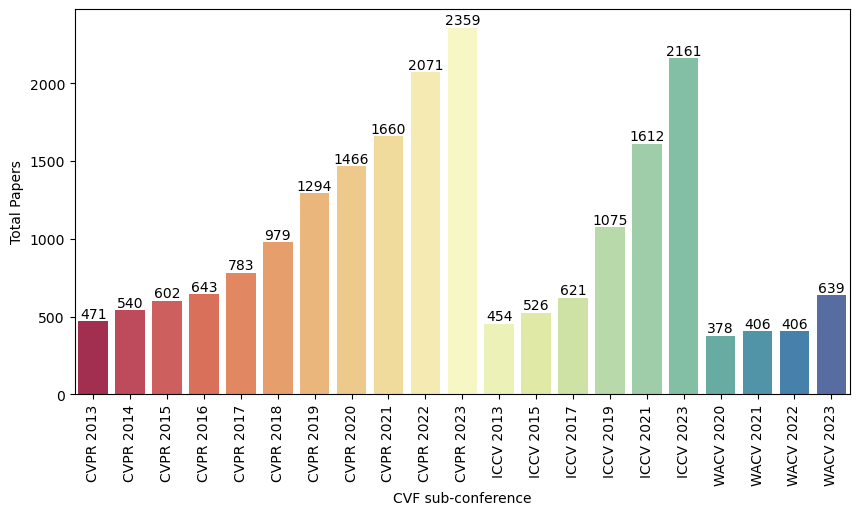
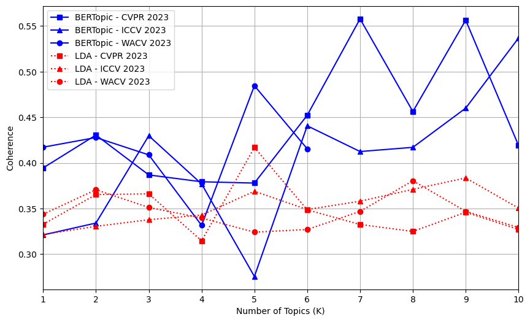
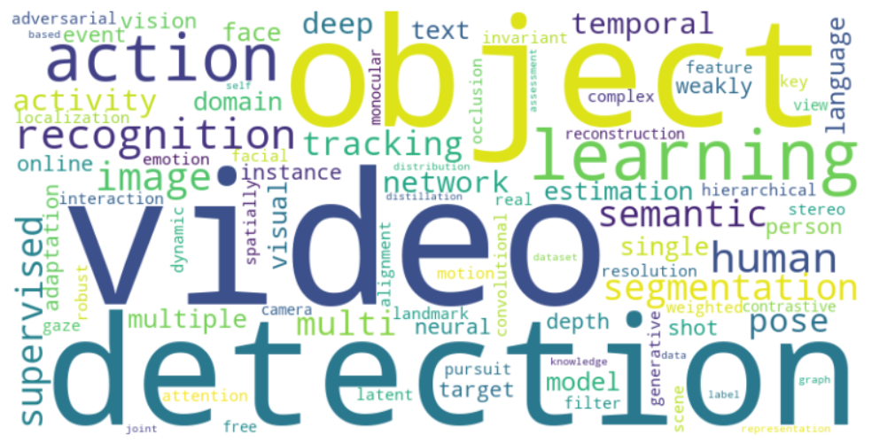

<p align="center"> 
  
</p>

> Figure 1. Proposed topic detection system on CFV conference papers

# Topic Detection on Computer Vision Foundation (CVF)
This paper aims to ...

## Background
This research is motivated by ...

## Computer Vision Foundation (CVF) Conference Data
The data we used is based on the titles and abstracts of papers presented at CVF conference, spanning from 2013 to 2023. These conferences fall into three different sub-conferences: </br>
- CVPR, held annually since 2013, covers machine learning for computer vision and understanding image and video.</br>
- ICCV is occurring every 2 years since 2013, focuses on pattern recognition, object recognition, and image segmentation.</br>
- WACV is starting in 2020 and also held annually, concentrates on 3D computer vision, adversarial learning and attack, and generative models for image, video, and 3D applications.</br>
<p> 
  
</p>

> Figure 2. Distribution of CVF conference data

As discussed earlier and illustrated in Fig. 2, each of these sub-conferences represents a different main scope and contains a varying number of papers. This diversity leads to a richer and more varied of the generated topic. Consequently, understanding and analyzing these topics becomes more complex and challenging. All papers presented at the CVF conference are publicly available on their website .

## Topic Modeling Techniques
- BERTopic with Cohere Embedding
- Latent Dirichlet Allocation (LDA)

## Insight of CVF Conference Topic Detection
<p align="justify">
Reflecting on the title and abstract results, topic detection at CVF conferences highlights evolving research trends. Object detection and image segmentation consistently emerge as prominent subjects, indicating ongoing improvements for faster and better performance. In the early years of CVPR and ICCV, traditional machine learning approaches, such as random forests, were common. However, around the mid-2010s, there was a shift toward deep learning, evidenced by the increasing prominence of terms like "neural network" and "CNN." More recently, trends have shifted again towards generative models, with terms like "GANs" and "transformers" becoming more common. These trends illustrate a dynamic research landscape, reflecting the evolution of AI and technology in addressing computer vision challenges. Table I summarizes the key topics identified in both titles and abstracts across all CVF sub-conferences.



> _Figure 3. Illustrates a comparison of coherence scores for CVF sub-conference papers from 2023, reflecting their significant recent contributions. The comparison focuses on coherence scores between BERTopic and LDA based on paper titles. Higher coherence scores indicate better quality in the generated topics. In the figure, BERTopic is represented by solid blue lines, while LDA is depicted with dotted red lines._ 

</p>

<p align="justify">
The topic of machine learning continues to emerge, particularly with terms related to supervised learning, such as self-supervised and weakly supervised learning, which address data availability challenges. The introduction of pre-trained models allows researchers to focus on improving the quality of low-resource datasets for optimal performance (Dhar, 2023). Additionally, recent years have seen interdisciplinary trends integrating computer vision with fields like natural language processing (NLP) and audio processing. This integration aims to develop versatile models capable of understanding multimodal tasks, such as text-to-image, text-to-video, and audio-visual tasks, to address real-world scenarios.
</p>

<p align="center">
  <strong>TABLE I. COMPARISON OF TOPIC DETECTION ON TITLE AND ABSTRACT</strong>
</p>

| No | Aspect | Abstract | Title |
|---|---|---|---|
| 1 | The primary research focus | A similar pattern occurring towards object detection and image segmentation for every year. Topics such as domain adaptation and 3D vision have also gained prominence in recent years. | There are clear trends through object detection, image segmentation, and image recognition for every year. In the recent years, knowledge distillation and domain adaptation become popular. |
| 2 | The evolution towards AI | From traditional machine learning to deep learning, and now to generative models (GANs and Transformers) | From deep learning shift toward attention and self-attention mechanism |
| 3 | Machine learning paradigm | Supervised and unsupervised | Supervised, self-supervised, and weakly supervised |
| 4 | Interdisciplinary trends | audio-visual | Text-to-image and text-to-video |
</br>
<p>
  
</p>

> Figure 4. Example of word cloud by BERTopic 

## Our Works
This repository contains all the hardworks of our research and divide into several folders:<br>
- Dataset: The Dataset that used in this research
- BERTopic & LDA: The code that we used in this research
- Result: Containing complete results in excel format document, both BERTopic and LDA

## Paper & Citation

Our research can be accessed through this website below:
* ...
```bibtex
@misc{..,
  doi = {...},
  url = {...},
  author = {Basuki, Indrabayu, and ...},
  keywords = {ICCV, CVPR, WACV, BERTopic, Topic Detection},
  title = {...},
  publisher = {...},
  year = {2024},
  copyright = {Creative Commons Attribution 4.0 International}
}
```